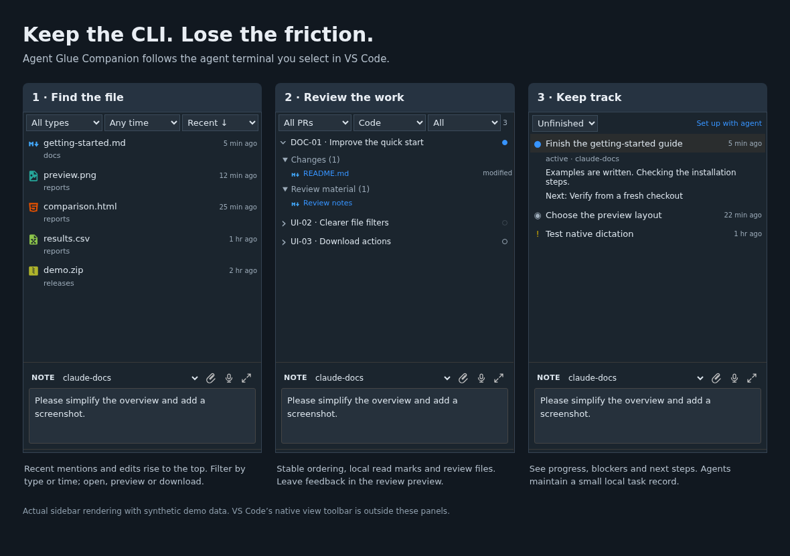
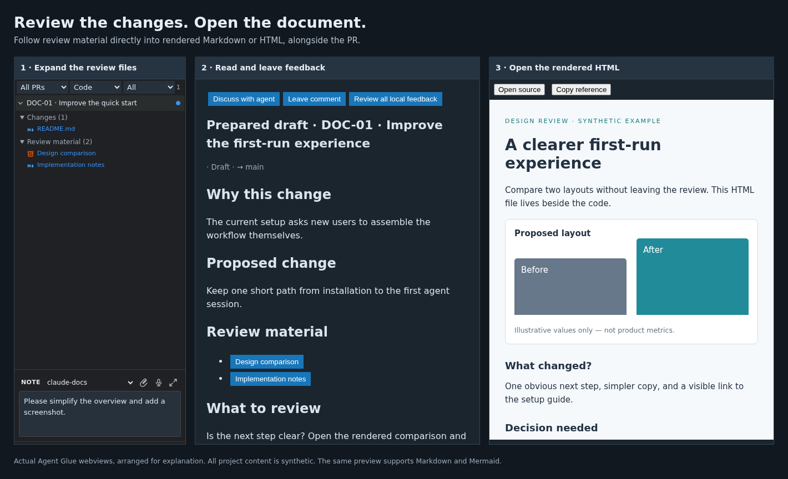

# Agent Glue

> **Disclaimer**
>
> Technically this is mental health device for the terminally AI-pilled. Designed to reduce “but what if my agents need me?” anxiety so you can close the laptop and go to sleep. Also helps with hair pulling.
>
> Not FDA approved. Currently available as a black-market digital wellness offering under the MIT licence. Side effects may include going outside.

Close your laptop without worrying about rebuilding your agent sessions tomorrow.

Agent Glue stays as close as possible to the intended Claude, Codex and VS Code
workflow. Keep the real CLIs, native terminals, account settings and updates.
Add only the small pieces that make everyday work less painful. Intentionally
minimal: terminal continuity and a useful sidebar, with the agents themselves
still running in their normal CLIs.

It is best used with **VS Code Remote SSH to an always-on server**: agents run in
tmux on the server while your laptop is just the interface. Close the laptop or
turn it off, then reconnect later. The server must stay running.

The extensions handle named terminal sessions, files across projects, lightweight
reviews, and getting notes and images into remote agents. The local helper brings
back clipboard-image attachment and Mac dictation where remote terminal workflows
make them awkward. No replacement agent runtime or central orchestration service.



*Actual Companion sidebar rendering with invented data. The native VS Code
view toolbar is outside these panels. The earlier Tasks example is now the
per-terminal Status view.*

## Two extensions, two jobs

| Extension | What it does |
| --- | --- |
| **[Sessions](packages/sessions/README.md)** | Attaches named tmux sessions to native VS Code terminal tabs and reconnects them after disconnects or window reloads. |
| **[Companion](packages/companion/README.md)** | Adds the Agent Glue sidebar: Files, PRs, terminal status, and a note field with attachments and optional dictation. Follows the terminal you select, even outside the open workspace folder. |

Install either independently. Companion needs Sessions only to focus or paste
into an agent terminal or fork conversations. A bundled local helper supplies native downloads and,
on macOS, dictation and clipboard images.

## What gets easier

- **Come back tomorrow.** Sessions reconnects to agents you started in tmux.
  Your remote host must stay running: tmux survives closing the laptop, not
  rebooting the server. Agent Glue does not automatically wrap ordinary shells.
- **Recover after a server restart.** Sessions saves recent session metadata on
  disk. When a recorded resume ID and the CLI's saved conversation are available,
  it offers an `agent restore: …` task to recreate the named tmux session and
  resume that conversation. This can help after a power cut, but does not preserve
  running processes, unsaved work or a conversation the CLI never saved.
- **Branch a conversation.** Right-click a terminal tab and choose **Agent Glue: Fork Conversation**,
  confirm or browse to a folder on the workspace host, and continue the saved
  history in a separately named tmux terminal. The original keeps running.
  Different folders do not copy project files or create Git worktrees. Forking
  needs a discoverable saved conversation and a CLI with native fork support;
  ambiguous identities fail explicitly rather than selecting another chat.
  After choosing the folder, keep **Same CLI / account** for that native fork,
  or choose another supported Claude/Codex account to start a fresh conversation.
  The new agent receives source session details, profile-directory mappings and
  saved task status, plus optional `/status` output you paste. This is a handoff,
  not a conversion of chat history. The original terminal stays untouched.
- **Open running apps.** Files includes a collapsed **Web apps** line with active
  responding-endpoint counts for this terminal and all terminals. Expand it to see filenames or page
  paths beside links. Apps are discovered from terminal URLs and server processes. Click to open in VS Code's main editor; right-click for
  **Open in browser** or **Copy link** through SSH forwarding. **All** lists
  services across agent terminals and projects. Entries distinguish webpages, APIs/services, redirects, HTTP errors and unreachable endpoints. Multiple page links on the same server are retained. Ports owned directly by Claude/Codex processes are excluded, even when their URLs appear in terminal text; web servers launched by those agents remain discoverable. APIs/services, protected endpoints (401/403) and unreachable addresses are hidden by default and can be shown in All. Discovered ports are labelled as guessed homepages; **Diagnostics** explains the response and discovery source, with an external-browser option for blank pages. These are HTTP checks, not proof that a page rendered successfully. Process discovery uses `ss` or
  `lsof`; local URLs still work without those tools. Detached services can only
  be associated if their ancestry was observed or their URL was shared.
- **Keep accounts separate.** Run multiple Claude or Codex logins side by side
  using separate CLI configuration directories—for example, personal and client
  subscriptions. Agent Glue keeps their terminals organised and supports the
  account-directory conventions described [below](#multiple-accounts-and-client-subscriptions).
  Sign-in and credentials remain with the CLIs.
- **Find the file.** Paths mentioned in the selected terminal appear in Files.
  Recent mentions and edits sort newest-first. Filter by type or time, sort by
  name, and pin useful files. Open across projects without opening another
  VS Code window; right-click to download.
- **Read and review.** Preview Markdown, Mermaid diagrams, images and HTML.
  Review hosted PRs or prepared local changes. Keep stable ordering, mark items
  read, and leave local feedback for your AI before anything is pushed. Prepared
  local reviews do not require a published GitHub PR.
- **Live status beside terminal names.** Enable the **Terminals** selector to
  replace the native tab list. Hook events show amber working, red permission/input
  requested, green turn finished, and grey idle/unknown; working rows show minutes.
  **Enable Live Terminal Status** installs local observer hooks for existing standard
  Claude/Codex account directories. Codex requires `/hooks` trust review; existing
  CLI sessions may need to reload their hook configuration. No agents are restarted.
  Missing events and events older than 15 minutes show unknown. This uses no AI calls
  or conversation-history indexing. Moving the selector back restores the previous
  native-tabs setting.
- **See what this terminal is doing.** The sidebar title follows the selected CLI,
  such as `AG - claude2` or `AG - codexl`. **Terminal Status** (pulse icon) shows
  all unfinished tasks plus the three latest completions. Compact rows show
  status and update age; expand for the full title, plain-English progress,
  next step and supporting details. **🤖 Run** uses a separate one-off CLI call
  with the terminal’s agent account to summarize recent terminal output and
  merge updates into the saved list. New tasks are added and unfinished work
  stays visible even when it scrolls out of view. This uses tokens without
  messaging the active conversation. Reports are timestamped snapshots;
  ordinary Refresh reads saved reports without contacting an AI.
- **Send a clear note.** Write or dictate, attach a file or screenshot, then paste
  into the selected terminal. Drop local files up to 200 MB—including HTML—or paste absolute
  local file paths, quoted paths with spaces, or file URLs. The local helper
  copies them to the remote project's Git-ignored `.local/agent-glue/inbox/`
  and attaches the remote paths. Uploads keep the chosen recipient throughout
  the transfer. Check the recipient and press Enter yourself.

## Documents belong in the review

An agent's output is often a document, not just a code diff: a design proposal,
a comparison, a diagram or a small interactive HTML report. Agent Glue lets you
expand a PR's review material and open rendered `.md` or `.html` files immediately,
without hunting through the workspace or reading raw markup. Keep the explanation
beside the changes, then leave feedback for the agent.



*Real Agent Glue webviews arranged for explanation. The project and document
content are invented. [How to prepare review material](docs/project-reviews.md).*

## Install from source

This is an **early release**, not a Marketplace installation. You build the VSIX
packages locally. MIT licensed; free to use, modify, redistribute and sell.

| Requirement | Where it is needed |
| --- | --- |
| VS Code 1.100+ with a trusted, non-virtual workspace | Your desktop / SSH window |
| Linux or macOS, `git`, `tmux` | Workspace host (remote machine for SSH) |
| `zsh`, `jq` | Workspace host, for Sessions |
| Node 22 and npm | Machine used to build the extensions |
| Claude or Codex CLI, installed and authenticated separately | Workspace host |
| GitHub CLI (`gh`), authenticated | Optional: hosted PR browsing and posting |
| macOS Dictation and Accessibility permission | Optional: local Mac dictation |

```sh
git clone https://github.com/knotwerk/agent-glue.git
cd agent-glue
npm ci
npm test
npm run check
npm run package
```

1. In VS Code, run **Extensions: Install from VSIX…** and select the Sessions and
   Companion packages under `dist/vsix/`.
2. In Remote SSH, install both on the **remote host**. The bundled helper belongs
   **locally** and is installed through Companion when needed. Reload the window.
3. Disable the old “Tmux Claude/Codex Attach” extension if you used it previously.
   It conflicts with Sessions.
4. Open the project on the workspace host and start your agent inside tmux:

   ```sh
   tmux new-session -s claude-my-project
   # In the new session:
   claude
   ```

   For Codex, use a session name such as `codex-my-project` and run `codex`.
5. Run **Agent Glue: Attach Agent Tmux Sessions**, select its terminal tab, then
   open **Agent Glue** in the activity bar. The view title offers Files, PRs, Status (pulse icon), and
   Refresh. Mention an existing file path to populate Files.

For attachments, local feedback and task records, ignore `.local/agent-glue/`
in the agent's Git project. Use the project's `.gitignore`, or add the pattern
to `.git/info/exclude` for a local-only choice. This does not untrack files that
were already committed.

## Multiple accounts and client subscriptions

Keep the personal account on `claude` / `codex` and give a client account its own
configuration directory. Add these functions to **the server’s** `~/.zshrc`:

```zsh
claude2() { CLAUDE_CONFIG_DIR="$HOME/.claude2" command claude "$@"; }
codex2()  { CODEX_HOME="$HOME/.codex2" command codex "$@"; }

# Reconnect to this named tmux session, or create it in the current directory.
alias client-claude='tmux new-session -A -s claude2-client -c "$PWD" zsh -ic claude2'
alias client-codex='tmux new-session -A -s codex2-client -c "$PWD" zsh -ic codex2'
```

Create the directories with `mkdir -p ~/.claude2 ~/.codex2`, restrict them with
`chmod 700 ~/.claude2 ~/.codex2`, and open a new terminal to load the functions.
For per-directory Codex credentials, add `cli_auth_credentials_store = "file"`
to `~/.codex2/config.toml`, preserving any existing settings. Run `codex2 login`
and `claude2` to sign in separately. Check the displayed account before working;
an inherited API key can select API billing instead of a subscription.

Then `cd` to the project and run `client-claude` or `client-codex` outside tmux.
For concurrent tasks, use distinct session names such as `claude2-client-docs`
and `claude2-client-tests`. Reusing a name reconnects its existing process.

Settings presets—Codex `--profile` and Claude `--settings`—are different from
account isolation. Follow the current [Codex configuration](https://developers.openai.com/codex/config-advanced/),
[Codex authentication](https://developers.openai.com/codex/auth/) and
[Claude authentication](https://code.claude.com/docs/en/authentication) guidance.
The Claude directory example is for claude.ai subscriptions; Console OAuth
profiles have different storage rules.

Live tmux sessions retain their account and environment. Agent Glue’s restart
helper recognizes `codex2`/`codex3`/`codexl` and `claude2`/`claudel`/`claudelp`,
each using the corresponding hidden directory under your home. Arbitrary custom
aliases and extra CLI flags need manual restart. Agent Glue does not add
permission-bypass flags or manage your credentials.

## Everyday controls

| View | Useful actions |
| --- | --- |
| Files | Click to open; right-click to download or copy the path. Recent ↓ uses mentions or edits; the small timestamp shows disk modification time. Show more expands 20 files at a time, up to 100 recents. |
| PRs | Click a name to open its review; expand the chevron for files. The right-hand dot marks read/unread; blue indicates new comments. **Leave comment** saves locally for prepared reviews, or posts to GitHub for hosted PRs. |
| Status (pulse icon) | **🤖 Run** summarizes recent terminal output through a separate CLI call. Uses tokens; reports are timestamped snapshots, not live process activity. |
| Terminal tab | Right-click → **Agent Glue: Fork Conversation**; confirm or browse to the new terminal’s folder. |
| Web apps (above Files) | Open a running app; right-click for browser/copy options. Expand the single-line summary for this terminal; **All** lists apps across terminals. |
| Note | Choose a recipient, drop files or paste local file paths, then paste the note into the terminal. The local helper transfers files over SSH; microphone and clipboard-image actions are available on Mac. |

Missing files? Check **All types / Any time**, use **Show all** if filters hide
files, or select **Refresh**. Only the selected pane's last 2,000 lines are
captured while the sidebar is visible. Mention the path again or use **Pin file**
if it has scrolled away. **Choose Session** handles an unmatched terminal.

## Limits and privacy

Agent Glue runs with the extension host's permissions. It does not index CLI
conversation histories or provide a sandbox for untrusted projects. Recent paths,
notes, status snapshots and selections persist in VS Code workspace state. Task and local review
records stay in the project's ignored local directory.

Native open/download actions use VS Code's connection. Optional **Open in browser**
links require a reachable ZeroTier network and act as temporary bearer links;
keep them private. See the [security model](docs/security.md).

Automated tests cover synthetic terminal responses, a fake VS Code host and
browser interactions. Native Mac gestures, remote attachment and editor placement
still need [manual acceptance](CONTRIBUTING.md#manual-acceptance) on your setup.

## More detail

[Companion guide](packages/companion/README.md) ·
[Sessions guide](packages/sessions/README.md) ·
[Mac helper](packages/mac-dictation/README.md) ·
[Project reviews](docs/project-reviews.md) ·
[Contributing](CONTRIBUTING.md)

## License

[MIT](LICENSE). Free to reuse and change, including commercially. Keep the license
and copyright notice with copies or substantial portions. No warranty is provided.
Bundled libraries and icons retain their own license notices.
